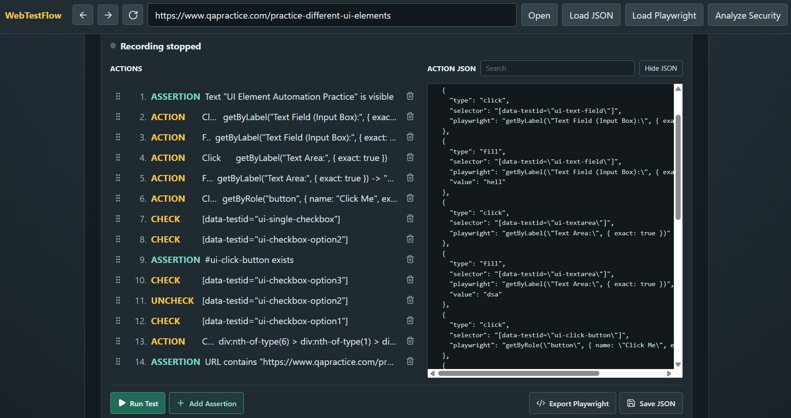
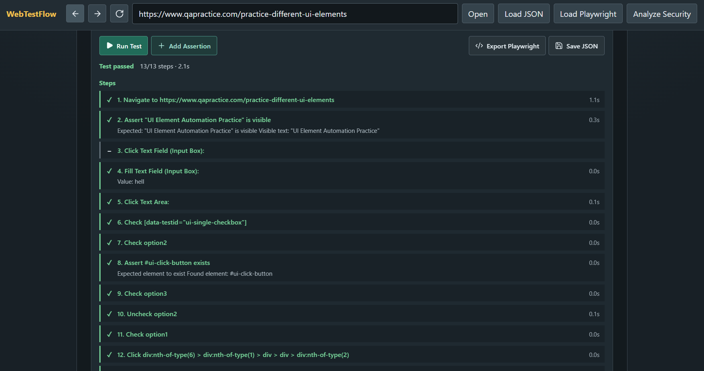
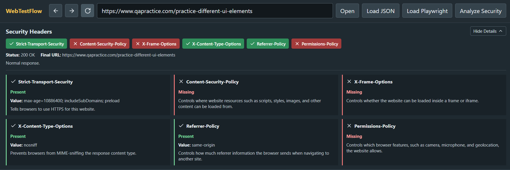
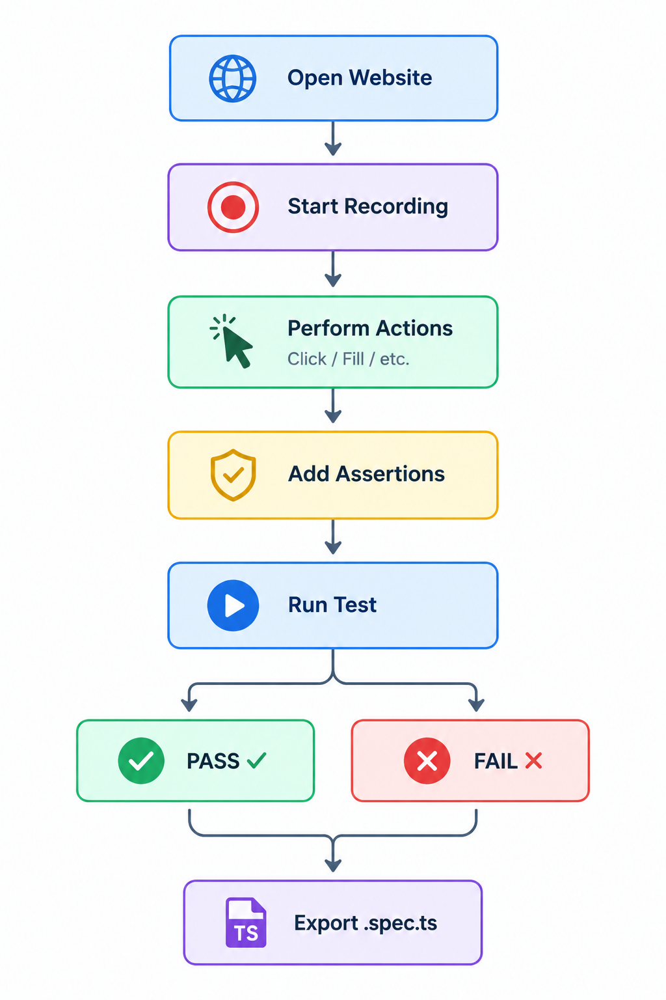
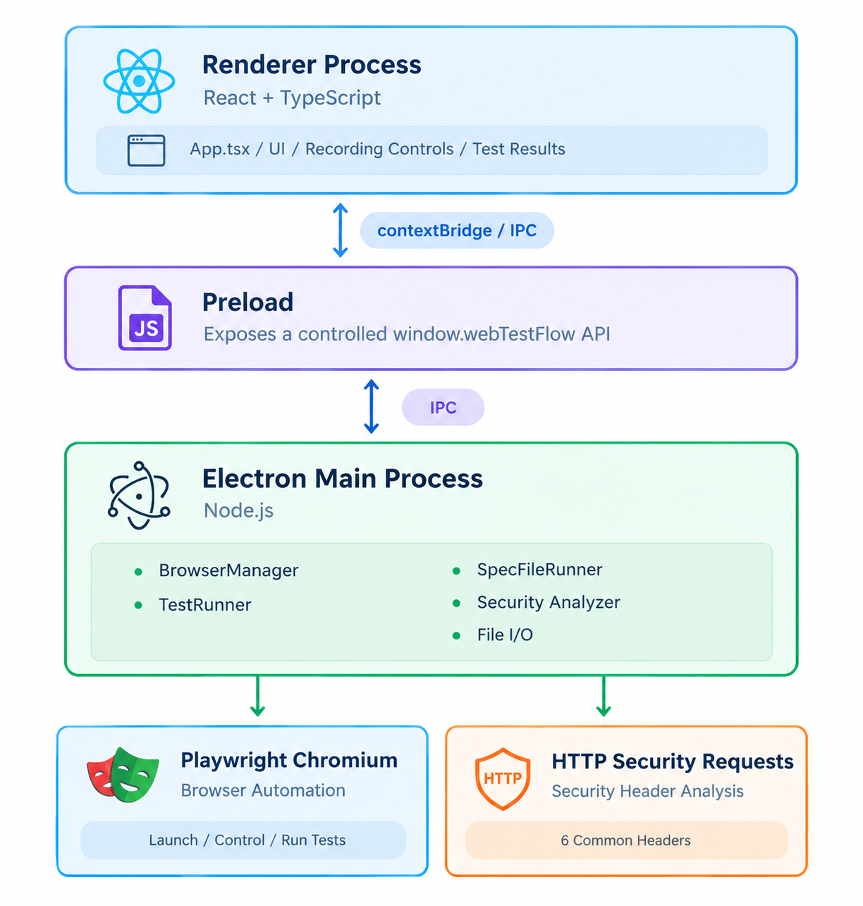

# WebTestFlow

### Visual Web Test Automation & Security Header Analyzer

[](https://www.electronjs.org/)
[](https://react.dev/)
[](https://www.typescriptlang.org/)
[](https://playwright.dev/)
[](https://vite.dev/)
[](https://www.microsoft.com/windows)

> **WebTestFlow** is a Windows desktop application that makes browser test automation easier through a visual interface. Record browser interactions, edit the test flow, add assertions, replay it with Playwright, and export it as a real Playwright TypeScript test.
>
> It also includes a **Security Header Analyzer** for checking common HTTP security response headers without requiring a browser.

---

## Screenshots

| Test Recording | Test Results |
|---|---|
|  |  |

| Security Header Analyzer |
|---|
|  |

---

## Features

### Visual Test Recording

Record browser interactions without manually writing Playwright code.

- Open a website in a controlled Chromium browser
- Record navigation, clicks, text input, form submission, select dropdown choices, and checkbox/radio changes
- Continue an existing recording
- Start a new recording
- Reorder and delete recorded actions
- Edit the underlying JSON when more control is needed

### Test Assertions

Add checks to verify that a workflow actually produces the expected result.

Supported assertions include:

- URL contains a value
- Text is visible
- Element exists
- Page title matches
- Element state is enabled, disabled, checked, or visible

Assertions are added manually and become part of the same recorded test flow.

### Playwright Test Replay

Run recorded JSON tests in a fresh Playwright-controlled Chromium instance.

- Step-by-step execution
- Live progress
- Pass/fail status
- Failed-step information
- Test duration
- Clean browser startup and shutdown
- Failure screenshots with the failing element highlighted
- Debug a failure by opening the page and highlighting the element

#### Debugging failed steps

Each failed step can be clicked to jump to the matching action in the test flow. Two additional actions help diagnose failures:

- **View screenshot** - opens a full-page screenshot captured at the moment of failure, with the failing element outlined.
- **Open page** - reopens the recording's start URL in the recording browser and highlights the failing element on the live page.

Failure screenshots are stored in the application's data directory and are cleaned up automatically after a retention period.

### JSON Test Editing

Recordings are stored as versioned JSON, making them easy to inspect and modify.

- **Find in JSON** to search actions with match highlighting and navigation.
- **Double-click** the JSON to edit it in place at the cursor position, then apply or cancel changes.
- Reorder actions by dragging, and delete individual actions from the flow list.

Example:

```json
{
  "version": 1,
  "name": "login-test",
  "createdAt": "2026-10-01T10:00:00.000Z",
  "startUrl": "https://example.com/login",
  "actions": [
    {
      "type": "fill",
      "selector": "input[name=\"email\"]",
      "playwright": "getByLabel(\"Email\")",
      "value": "user@example.com"
    }
  ]
}
```

### Playwright TypeScript Export

Export a recording as a real Playwright `.spec.ts` file.

Generated tests use Playwright Test and include named `test.step()` blocks so individual actions can be tracked clearly.

The exported test can also be edited manually and loaded back into WebTestFlow for execution through the Playwright Test CLI.

### Security Header Analyzer

Analyze common HTTP response security headers directly from the application.

WebTestFlow checks:

| Header | Purpose |
|---|---|
| `Strict-Transport-Security` | Helps enforce HTTPS connections |
| `Content-Security-Policy` | Controls allowed content sources |
| `X-Frame-Options` | Helps prevent clickjacking |
| `X-Content-Type-Options` | Helps prevent MIME-type sniffing |
| `Referrer-Policy` | Controls referrer information |
| `Permissions-Policy` | Controls access to browser features |

The analyzer reports headers as **Present**, **Missing**, or **Review** where appropriate. It also displays response status and final URL information.

WebTestFlow does not attempt to bypass security challenges such as Cloudflare protection. A `403` or `429` response is reported as the response received by the analyzer.

---

## Typical Workflow


A recording can also be saved as JSON and loaded again later.

---

## Locator Strategy

WebTestFlow records both a CSS selector and, where possible, a semantic Playwright locator.

Examples of supported locators include:

```text
#login-remember
[data-testid="login-remember"]
input[name="email"]
getByRole("button", { name: "Sign In", exact: true })
getByText("Dashboard", { exact: true })
getByLabel("Email")
getByPlaceholder("Search")
locator("input[name=\"email\"]")
```

The recorder prefers semantic locators such as `getByRole()`, `getByLabel()`, and `getByPlaceholder()` when they uniquely identify an element. When a semantic locator would be ambiguous, WebTestFlow falls back to a unique CSS locator rather than guessing with `.first()`.

This approach is intended to reduce brittle selectors and make recorded tests more reliable across page changes.

---

## Architecture

WebTestFlow uses Electron's main process, preload bridge, and renderer process to separate the UI from privileged Node.js operations.




### Electron Security Model

The renderer is configured with:

- `contextIsolation: true`
- `nodeIntegration: false`
- A controlled `contextBridge` API

The React UI therefore does not directly access Node.js APIs. File operations, browser automation, HTTP analysis, and Playwright Test execution are handled by the Electron main process.

---

## Tech Stack

| Area | Technology |
|---|---|
| Desktop | Electron |
| Frontend | React 19 |
| Language | TypeScript |
| Build tool | Vite |
| Browser automation | Playwright |
| Test framework | Playwright Test |
| Backend/runtime | Node.js through Electron main process |
| Icons | lucide-react |
| Development tools | concurrently, wait-on |

---

## Project Structure

```text
WebTestFlow/
│
├── src/
│   ├── main/                # Electron main process and services
│   │   ├── browser/         # Browser control, recording, and locator resolution
│   │   ├── ipc/             # Communication between processes
│   │   ├── recording/       # JSON storage, Playwright export, and screenshot cleanup
│   │   ├── security/        # HTTP security header analysis
│   │   └── tests/           # JSON replay and spec test execution
│   │
│   ├── preload/             # Secure IPC bridge (contextBridge)
│   │
│   ├── renderer/            # React desktop application UI
│   │   └── components/      # UI components
│   │
│   └── shared/              # Shared types and utilities
│
├── docs/
│   └── screenshots/         # README images
│
├── public/
├── package.json
├── tsconfig.json
└── README.md
```

> The exact file list may change as the project evolves. The structure above highlights the main architectural areas.

---

## Getting Started

### Prerequisites

- Windows
- Node.js
- npm
- Git

Playwright manages the Chromium browser used by the application. If the required browser binaries are not installed, install them with the Playwright CLI used by the project.

### 1. Clone the repository

```bash
git clone <YOUR-GITHUB-REPOSITORY-URL>
cd WebTestFlow
```

### 2. Install dependencies

```bash
npm install
```

### 3. Start the development application

```bash
npm run dev
```

This starts the Vite development server and launches Electron.

### 4. Build the application

```bash
npm run build
```

### 5. Run the built application

```bash
npm run start
```

---

## Testing Workflow

### Record a test

1. Launch WebTestFlow.
2. Open the target website.
3. Start recording.
4. Perform the workflow normally.
5. Stop recording.
6. Review or edit the recorded actions.
7. Add assertions where needed.
8. Save the recording as JSON.

### Replay a test

Run the recording using the built-in test runner. WebTestFlow launches a fresh Chromium instance and executes the recorded steps independently from the interactive recording browser.

### Export a Playwright test

Export the recording to a `.spec.ts` file when you want a normal Playwright Test file that can be inspected or edited manually.

### Load and run an edited spec

Edited Playwright `.spec.ts` files can be loaded back into WebTestFlow and executed using the Playwright Test CLI.

---

## Security & Reliability Considerations

WebTestFlow is designed to keep the security analyzer honest and the automation engine predictable.

- Browser automation is isolated from the React renderer through Electron IPC.
- Semantic locators are only preferred when they are unique.
- Ambiguous semantic locators fall back to unique CSS selectors.
- Recorded navigation is deduplicated when it is already represented by a link click.
- Text input is debounced so normal typing becomes a single fill action.
- Select dropdown choices replay through `selectOption()` by option value or label.
- Checkbox and radio interactions are recorded as `check` and `uncheck` actions.
- Test execution uses a separate browser instance from the interactive recorder.
- Running tests supports stopping and cleanup.
- Security analysis reports the HTTP response it actually receives rather than attempting to bypass WAF or challenge systems.

### Important limitation

Security-header results can differ between scanners because websites may return different responses depending on request headers, IP address, cookies, timing, redirects, or WAF/CDN behavior. A `403` response from WebTestFlow therefore represents the response received by WebTestFlow, not necessarily every response another scanner may receive.

---

## Roadmap

### Completed

- [x] Phase 1 — Desktop Application
- [x] Phase 2 — Playwright Integration
- [x] Phase 3 — Action Recording
- [x] Phase 4 — Recording Storage & Export
- [x] Phase 5 — Test Replay
- [x] Phase 6 — Security Header Analyzer
- [x] Phase 7 — Test Assertions
- [x] Phase 8 — Test Results

### Future

- [ ] Phase 9 — Advanced Test Execution
  - [ ] Test suites
  - [ ] Run multiple tests
  - [ ] Smoke-test suites
  - [ ] Parallel test execution
  - [ ] Retry failed tests
  - [ ] Test execution history

The roadmap may change as the project develops.

---

## Current Scope

WebTestFlow currently focuses on a simple workflow:

> **Record → Edit → Assert → Replay → Export**

It is intended to reduce the barrier to browser test automation while still producing real Playwright tests that can be inspected and modified by developers and testers.

The Security Header Analyzer is a separate utility for quickly checking common HTTP security headers from the same desktop application.

---

## Limitations

- WebTestFlow is currently designed for Windows desktop use.
- Recorded tests depend on the target website's DOM and accessible names.
- Highly dynamic websites may still require manual selector or test editing.
- Some websites may block automated requests or browser automation.
- Security-header results can vary when a website uses Cloudflare or another WAF/CDN.
- The advanced test-suite features in Phase 9 are not implemented yet.

---

## Project Documentation

The repository can contain two levels of documentation:

- **`README.md`** — public project overview, setup, features, architecture, and roadmap.
- **Project guide / technical notes** — deeper explanations of implementation details and interview talking points.

Keeping the public README focused makes the GitHub repository easier to understand while allowing detailed technical documentation to remain available separately.

